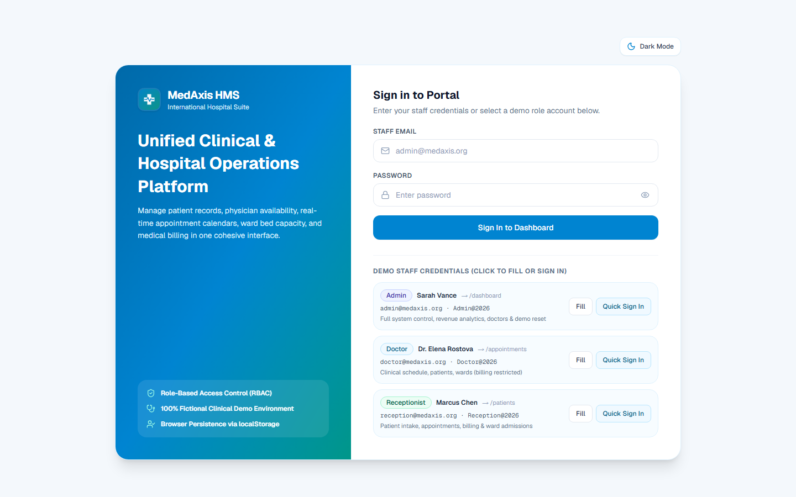
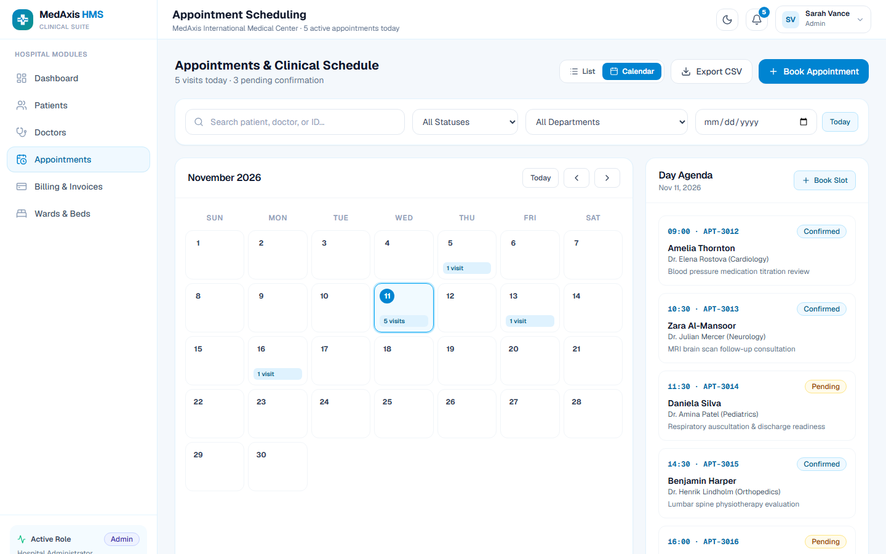
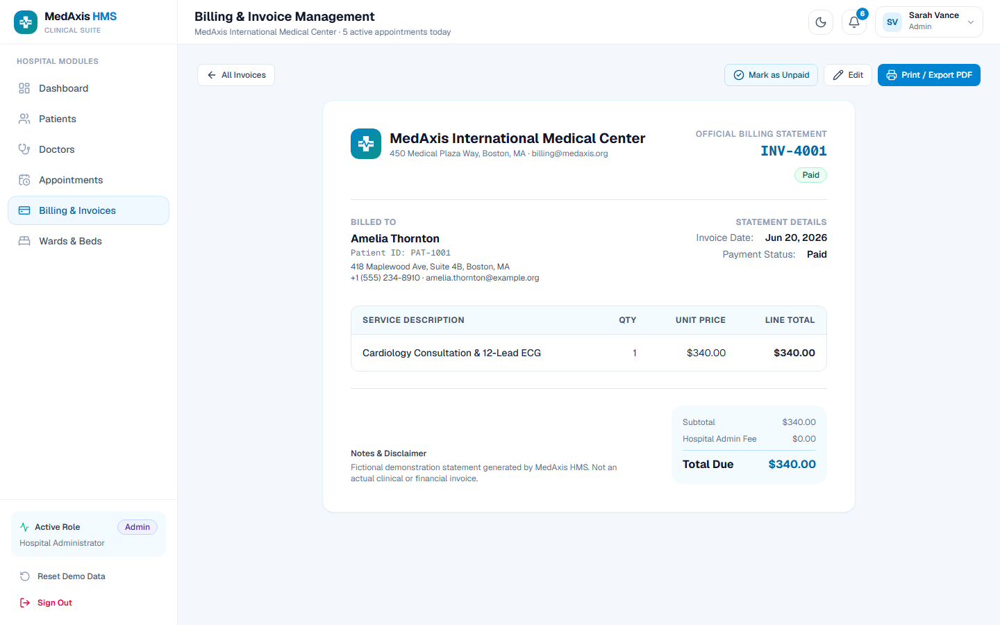
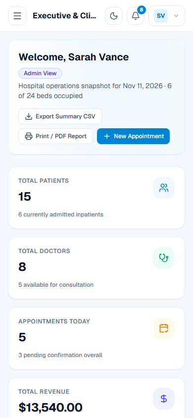

# Virtual Code Tech — Hospital Management System (MedAxis HMS)

A modern, responsive, clinical frontend application designed for hospital administration, staff coordination, and patient care workflows. Built with Next.js 16 (App Router), React 19, TypeScript, Tailwind CSS v4, Zustand with browser persistence, and Recharts.

---

## 1. Project Title & Overview

- **Project:** Virtual Code Tech — Hospital Management System
- **Codename:** MedAxis HMS
- **Target Repository:** `danishalipny-pixel/Virtual-Code-Tech-Hospital-managment-system`
- **Architecture Model:** Client-first Single Page Application with zero backend dependencies, utilizing Zustand in-memory state backed by local JSON fixtures and browser `localStorage`.
- **Clinical Data Notice:** All patient names, physician profiles, medical histories, invoices, and bed allocations are fictional simulation data.

---

## 2. Executive Summary

MedAxis HMS provides hospital administrators, physicians, and receptionists with an integrated workspace for hospital operations:

- **Executive Analytics:** Real-time calculation of admitted patient volumes, physician staffing levels, today's appointments, and financial revenue.
- **Role-Based Workflows:** Distinct permissions and entry points tailored for Hospital Admins, Attending Doctors, and Front-Desk Receptionists.
- **Operational Modules:** Patient directories, doctor registries, appointment schedules with calendar views, billing ledgers with invoice generation, and real-time ward capacity tracking.
- **Visual Design:** Medical clean aesthetic with dual-theme support (Light mode and Dark mode with anti-flash script).

---

## 3. Key Features

- **Authentication & RBAC:** Simulated credentials with one-click quick login for 3 roles and route-level protection.
- **Live Metrics Dashboard:** Recharts Area, Bar, and Donut charts tracking patient trends, revenue collection, and department workload.
- **Patient Management:** Full CRUD operations, filtering by blood group and admission status, medical history, and profile records.
- **Doctor Directory:** Specialty filters, roster cards, interactive availability toggles, and detail views.
- **Appointment Scheduler:** Multi-status appointment tracking, rescheduling workflows, and interactive calendar day agenda view.
- **Billing & Invoices:** Automatic total computation (`Quantity × Unit Price`), payment toggles, and print-ready PDF invoice templates.
- **Ward & Bed Tracker:** Real-time occupancy monitor across 6 specialized hospital wards (ICU, Cardiology, Pediatrics, etc.) with admit and discharge operations.
- **CSV Data Export:** RFC-4180 compliant export with spreadsheet formula injection protection.
- **Automated Vitest Suite:** 15 unit and component tests verifying business calculations, store mutations, schemas, and UI components.

---

## 4. Technology Stack

- **Framework:** Next.js 16.4.6 (Turbopack, App Router)
- **Frontend Library:** React 19.3.0
- **Language:** TypeScript 5 (Strict Mode)
- **Styling:** Tailwind CSS v4.3.3
- **State Management:** Zustand 5.1.0 with `persist` middleware
- **Form Validation:** React Hook Form 7.92.0 + Zod 4.6.7
- **Data Visualization:** Recharts 3.10.1
- **Icons:** Lucide React 1.72.0
- **Testing Framework:** Vitest 5.1.0, React Testing Library, JSDOM

---

## 5. Architectural Overview

```
Client Browser
 ├── Next.js App Router (app/(dashboard)/...)
 ├── Zustand State Store (src/store/useHospitalStore.ts)
 │    ├── Seed JSON Datasets (src/data/*.json)
 │    └── Browser LocalStorage Sync (key: medaxis_hms_store_v1)
 ├── Presentation Layer (Tailwind CSS v4 + Recharts + Lucide)
 └── Form Validation Layer (React Hook Form + Zod v4)
```

Refer to [docs/ARCHITECTURE.md](docs/ARCHITECTURE.md) for full sequence diagrams and RBAC matrices.

---

## 6. Project Directory Structure

```
├── docs/
│   ├── ARCHITECTURE.md          # System architecture and data flow
│   ├── DATABASE.md              # Client-side relational entity model
│   ├── SETUP_GUIDE.md           # Installation and local development guide
│   ├── SECURITY.md              # Threat model and sanitization policies
│   └── screenshots/             # Interface screenshots across all views
├── public/
│   ├── avatars/                 # Local SVG doctor profile illustrations
│   └── medaxis-logo.svg         # Application brand asset
├── src/
│   ├── app/
│   │   ├── (dashboard)/         # Protected application layout & sub-routes
│   │   │   ├── appointments/    # Appointment calendar and listing
│   │   │   ├── billing/         # Invoices and financial ledger
│   │   │   ├── dashboard/       # Executive KPI dashboard & charts
│   │   │   ├── doctors/         # Doctor registry and profiles
│   │   │   ├── patients/        # Patient directory and profiles
│   │   │   └── wards/           # Ward & bed occupancy tracker
│   │   ├── login/               # Authentication portal
│   │   ├── globals.css          # Tailwind CSS design system tokens
│   │   └── layout.tsx           # Root layout with dark mode initializer
│   ├── components/
│   │   ├── layout/              # AppShell, Navbar, Sidebar
│   │   └── ui/                  # Button, Badge, Modal, Card, Table, FormFields
│   ├── data/                    # Seed JSON files (users, patients, doctors, etc.)
│   ├── features/                # Domain-specific components & schemas
│   ├── hooks/                   # useRoleAccess, useHydrated
│   ├── lib/                     # Utilities, CSV export, date helpers, metrics
│   └── store/                   # Central Zustand hospital store
├── CONTRIBUTING.md
├── package.json
└── vitest.config.mts
```

---

## 7. System Prerequisites

- Node.js 20.0 or higher
- npm 10.0 or higher
- Modern Chromium, Firefox, or Safari browser

---

## 8. Installation Instructions

```bash
# Clone the repository
git clone https://github.com/danishalipny-pixel/Virtual-Code-Tech-Hospital-managment-system.git
cd Virtual-Code-Tech-Hospital-managment-system

# Install dependencies
npm install
```

---

## 9. Data Storage & Persistence Configuration

The application requires no SQL or NoSQL database setup. It initializes automatically from seed files in `src/data/` and saves subsequent edits directly to browser `localStorage`. To reset the application to fresh factory data at any point, click the **Reset Demo Data** button located in the top navigation bar.

Refer to [docs/DATABASE.md](docs/DATABASE.md) for entity schemas and relationship diagrams.

---

## 10. Environment Variables

The project functions immediately without required environment variables. A template file `.env.example` is included:

```ini
PORT=3001
NEXT_PUBLIC_APP_URL=http://localhost:3001
NODE_ENV=development
```

---

## 11. How to Run the Application

### Development Mode

```bash
# Default (port 3000)
npm run dev

# Alternative (port 3001 - recommended if port 3000 is occupied)
npm run dev -- -p 3001
```

Access the application in your browser at: `http://localhost:3001`

### Production Build & Preview

```bash
npm run build
npm run start -- -p 3001
```

---

## 12. Available Modules

| Module Route | Description | Primary Actions |
| :--- | :--- | :--- |
| `/dashboard` | Executive KPI overview and analytics | View metrics, filter charts, export summary CSV |
| `/patients` | Patient directory | Add, edit, delete, view profile, export CSV |
| `/doctors` | Physician registry | Add, edit, toggle availability, view profile |
| `/appointments` | Clinical scheduling | Book, reschedule, cancel, view calendar |
| `/billing` | Accounts and invoices | Create invoice, toggle payment, print PDF bill |
| `/wards` | Facility occupancy | Track bed status, admit patient, discharge bed |

---

## 13. Authentication & Demo User Credentials

The login screen (`/login`) includes one-click demo credentials:

| Role | Email | Password | Primary Permissions |
| :--- | :--- | :--- | :--- |
| **Hospital Admin** | `admin@medaxis.org` | `Admin@2026` | Complete access to all hospital modules |
| **Doctor** | `doctor@medaxis.org` | `Doctor@2026` | Clinical views & schedule (`/billing` restricted) |
| **Receptionist** | `reception@medaxis.org` | `Reception@2026` | Patient intake, appointments, billing, admissions |

---

## 14. Testing Instructions

Run the automated test suite with Vitest:

```bash
# Run unit & component tests
npm test

# Run TypeScript typecheck
npm run typecheck

# Run ESLint
npm run lint
```

---

## 15. User Interface Gallery

| View | Screenshot |
| :--- | :--- |
| **Authentication Screen** |  |
| **Executive Dashboard (Light Mode)** |  |
| **Executive Dashboard (Dark Mode)** |  |
| **Patient Management Table** |  |
| **Doctor Directory** |  |
| **Appointment Calendar View** |  |
| **Billing Ledger & Invoice Detail** |  |
| **Ward & Bed Occupancy Monitor** |  |
| **Mobile Responsive Layout** |  |

---

## 16. Security Considerations

- **Formula Injection Defense:** CSV exports escape leading `=`, `+`, `-`, and `@` characters.
- **Input Validation:** All modal and form inputs pass through strict Zod v4 schemas.
- **Route Authorization:** Gated by `useRoleAccess` to enforce separation of clinical vs. financial actions.
- **No PHI Storage:** All medical data is fictional and stored solely within the local browser session.

See [docs/SECURITY.md](docs/SECURITY.md) for the complete security specification.

---

## 17. Troubleshooting

- **Port in Use (`EADDRINUSE: 3000`):** Pass `-p 3001` to use port 3001.
- **Stale Browser State:** Click "Reset Demo Data" in the top navigation bar to reset the Zustand store.
- **Build Cache Issues:** Delete `.next` and run `npm run build` afresh.

---

## 18. Future Roadmap

- Integration with a live REST/GraphQL backend (FastAPI / Express / Go).
- WebRTC video consultation links for telemedicine.
- Multi-currency billing and real payment gateway integration (Stripe).
- Real-time notification webhooks via WebSockets.

---

## 19. Contributing

Contributions are welcomed. Please review [CONTRIBUTING.md](CONTRIBUTING.md) for branch naming conventions, linting guidelines, and pull request procedures.

---

## 20. License

This project is licensed under the MIT License for educational and portfolio demonstration purposes.
