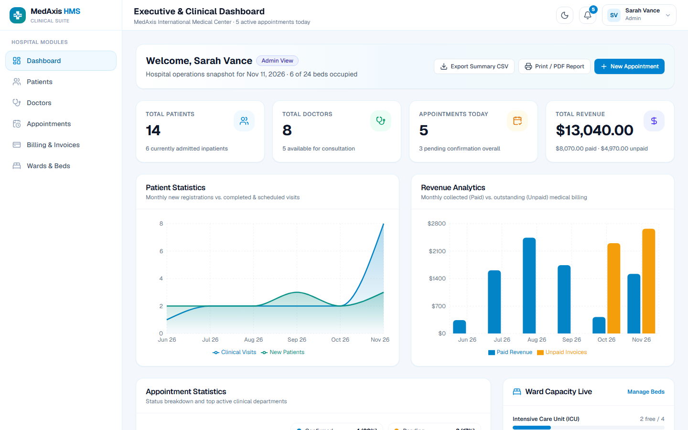
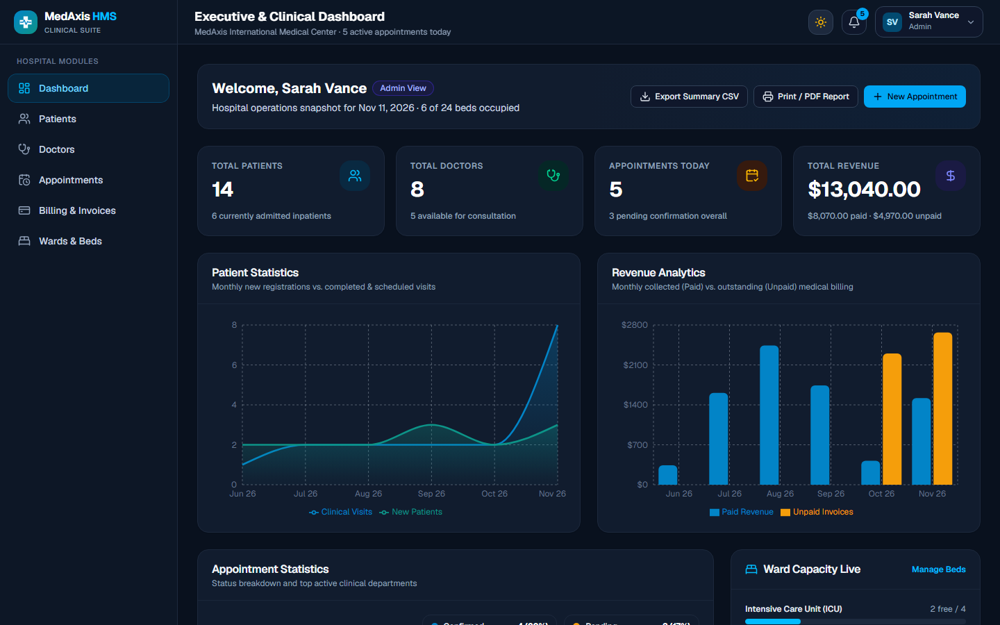
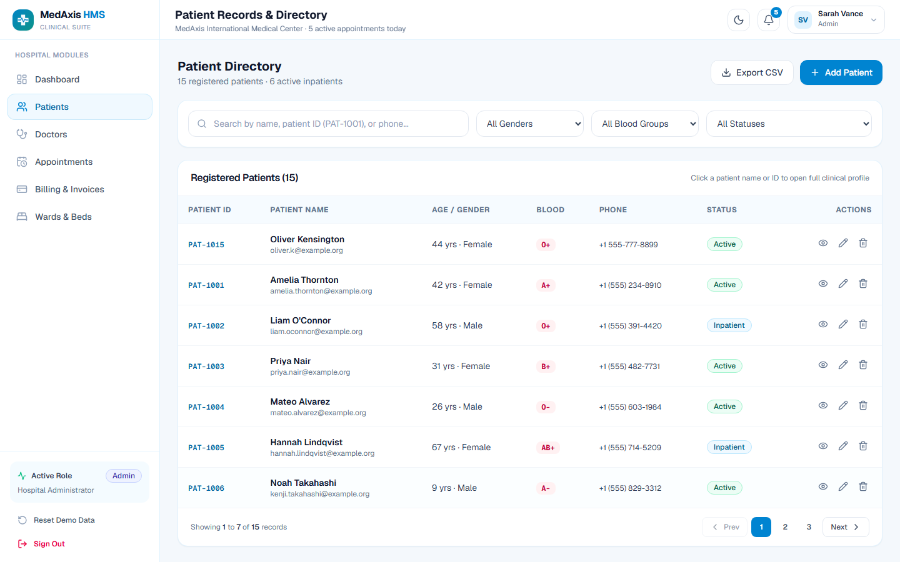
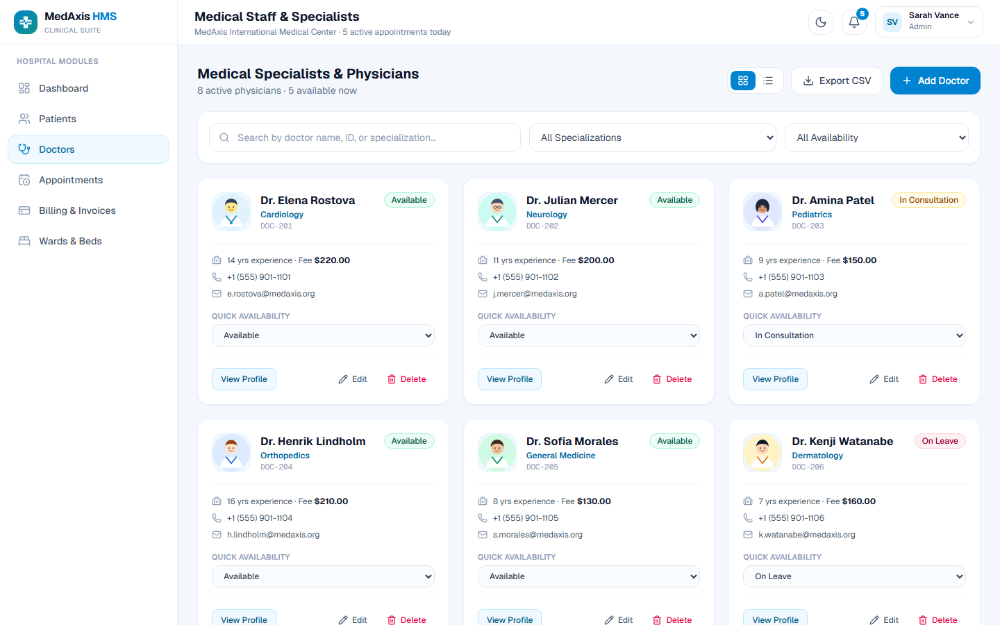
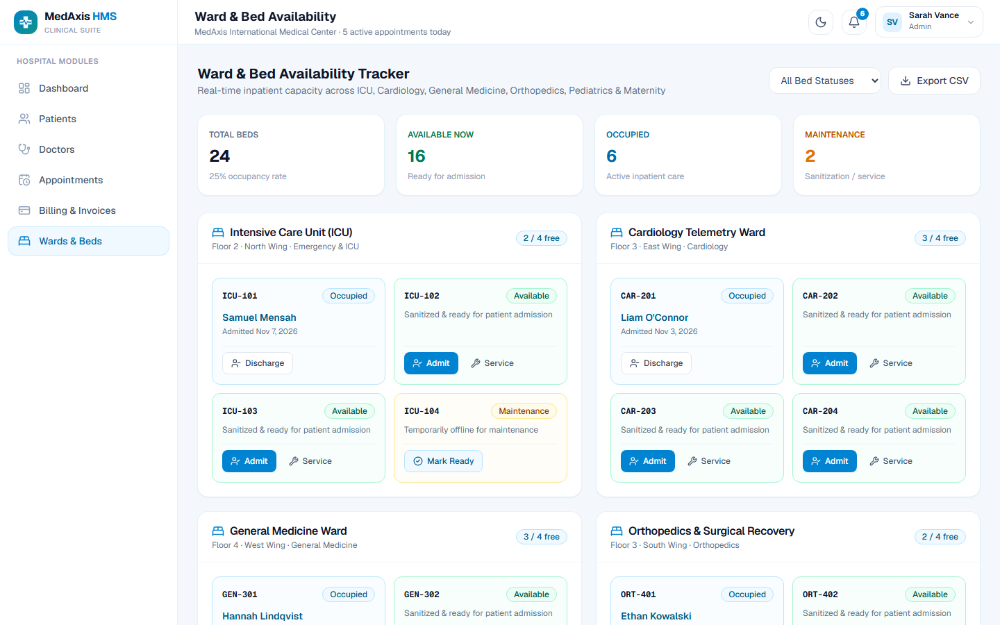

# MedAxis HMS — Hospital Management System


A complete, responsive, international-grade **Hospital Management System (HMS)** front-end application built with **Next.js (App Router)**, **React**, **TypeScript**, **Tailwind CSS v4**, **Zustand**, **React Hook Form + Zod**, **Recharts**, and **Lucide React**.

> **Disclaimer:** All patient records, physician profiles, clinical schedules, billing statements, and ward occupancy entries are **100% fictional demonstration data** persisted locally in the browser (`localStorage`). No backend, external database, or real patient data is used.

---

## Table of Contents

- [Project Overview](#project-overview)
- [Features](#features)
- [Role-Based Access Control (RBAC)](#role-based-access-control-rbac)
- [Technology Stack](#technology-stack)
- [Folder Structure](#folder-structure)
- [Demo Login Credentials](#demo-login-credentials)
- [Screenshots](#screenshots)
- [Installation & Local Development](#installation--local-development)
- [Running Tests, Linting & Production Build](#running-tests-linting--production-build)
- [Vercel Deployment Instructions](#vercel-deployment-instructions)
- [3–5 Minute Demo Walkthrough Guide](#35-minute-demo-walkthrough-guide)
- [Future Improvements](#future-improvements)

---

## Project Overview

**MedAxis HMS** unifies core hospital workflows into a clean white and light-blue medical software interface (with full Dark Mode support). Every metric, chart, table, and badge updates live from centralized Zustand client state backed by local JSON seed files and `localStorage` browser persistence.

---

## Features

### Core Modules
1. **Mock Authentication & Role-Based Access (`/login`)**
   - Validated login form (`React Hook Form` + `Zod`) with password visibility toggle and error handling.
   - One-click **Fill** and **Quick Sign In** demo credential cards for **Admin**, **Doctor**, and **Receptionist**.
   - Role-specific post-login redirects, route-level protection, `localStorage` session persistence, and one-click Sign Out.
2. **Executive & Clinical Dashboard (`/dashboard`)**
   - Live KPI cards calculated directly from application state: **Total Patients**, **Total Doctors**, **Appointments Today**, and **Total Revenue** (with Paid vs. Unpaid breakdown).
   - Interactive **Recharts** visualizations: **Patient Statistics** (Area Chart), **Revenue Analytics** (Bar Chart), and **Appointment Statistics** (Donut Status Breakdown + Top Departments).
   - **Live Ward Capacity** meter, **Recent Appointments**, **Recent Patients**, CSV summary export, and print-ready PDF Executive Report.
3. **Patient Management (`/patients` & `/patients/[id]`)**
   - Searchable, multi-filterable (`Gender`, `Blood Group`, `Care Status`), paginated patient table.
   - Add & Edit patient modals with full Zod validation, Quick View details modal, Delete with confirmation dialog, and CSV export.
   - Dedicated **Patient Profile** page displaying demographics, blood group, emergency contact, current ward/bed assignment, clinical notes, **Appointment History**, and billing records.
4. **Doctor Management (`/doctors` & `/doctors/[id]`)**
   - Grid and Table view switcher for medical specialists with local SVG portraits.
   - Search by name/ID/specialization, filter by Specialization and Availability (`Available`, `In Consultation`, `On Leave`).
   - Add, Edit, Delete (Admin-only) physicians with avatar preset selector, inline quick availability switcher, CSV export, and dedicated **Doctor Profile** pages.
5. **Appointment Management (`/appointments`)**
   - Book, Edit, Reschedule (dedicated modal), Confirm, Complete, and Cancel (with confirmation dialog) appointments.
   - Search and filter by Status, Department, and Date (with quick **Today** toggle).
   - **Interactive Monthly Calendar & Day Agenda** view alongside the paginated List view, plus CSV export.
6. **Billing & Invoices (`/billing` & `/billing/[id]`)**
   - Invoice ledger with live billing KPIs (`Total Billed`, `Collected Paid`, `Outstanding Unpaid`).
   - Create & Edit invoices with **automatic live total calculation** (`Quantity × Unit Price`).
   - One-click `Paid` / `Unpaid` status toggling, CSV export, and dedicated **Print / Export PDF** hospital invoice statement layout (`@media print`).

### Bonus Features Implemented
- **Dark Mode** with zero-flash SSR inline initialization and persisted preference.
- **Appointment Calendar View** with interactive day selection and side Day Agenda panel.
- **CSV Export** across Dashboard KPIs, Patients, Doctors, Appointments, Invoices, and Ward Beds (RFC-4180 compliant with spreadsheet formula sanitization).
- **Print / PDF Export** with clean `@media print` stylesheets hiding chrome/sidebars on Dashboard Executive Reports and Billing Invoices.
- **Ward & Bed Availability Tracker (`/wards`)** across 6 hospital wards (`ICU`, `Cardiology`, `General Medicine`, `Orthopedics`, `Pediatrics`, `Maternity`) supporting patient admission, bed discharge, and maintenance toggling.
- **Accessibility Enhancements**: semantic landmarks, skip-to-main-content link, `aria-modal` dialogs, `aria-live` toast notifications, accessible labels & error associations, and verified mobile responsiveness with zero horizontal overflow.
- **Automated Unit & Component Tests** with **Vitest** and **React Testing Library**.

---

## Role-Based Access Control (RBAC)

| Role | Post-Login Redirect | Permissions Summary |
| --- | --- | --- |
| **Admin** | `/dashboard` | Full access to Dashboard, Patients, Doctors (Add/Edit/Delete), Appointments, Billing (Add/Edit/Delete), Wards, and System Demo Reset. |
| **Doctor** | `/appointments` | Access to Dashboard, Patients (View/Add/Edit), Doctors (View & update own availability), Appointments (full schedule actions), and Wards. **`/billing` is restricted.** |
| **Receptionist** | `/patients` | Access to Dashboard, Patients (full CRUD), Doctors (View directory), Appointments (full CRUD), Billing (Create/Edit/Toggle/Print), and Wards (Admit/Discharge). Doctor roster add/delete is Admin-only. |

---

## Technology Stack

- **Framework:** Next.js `16.4.6` (App Router, Turbopack, Cache Components)
- **Library:** React `19.3.0`, TypeScript `5`
- **Styling:** Tailwind CSS v4 (`@tailwindcss/turbopack`)
- **State Management:** Zustand `5.1.0` (`persist` middleware to `localStorage`)
- **Forms & Validation:** React Hook Form `7.92.0`, `@hookform/resolvers`, Zod `4.6.7`
- **Charts:** Recharts `3.10.1`
- **Icons:** Lucide React `1.72.0`
- **Testing:** Vitest `5.1.0`, `@testing-library/react`, `@testing-library/jest-dom`, `jsdom`

---

## Folder Structure

```text
├── docs/
│   └── screenshots/                # Verified UI screenshots across modules
├── public/
│   ├── avatars/                    # Local SVG physician portraits (doctor-1..8.svg)
│   └── medaxis-logo.svg            # Brand emblem
├── src/
│   ├── app/
│   │   ├── (dashboard)/            # Protected AppShell layout & feature routes
│   │   │   ├── appointments/
│   │   │   ├── billing/[id]/
│   │   │   ├── billing/
│   │   │   ├── dashboard/
│   │   │   ├── doctors/[id]/
│   │   │   ├── doctors/
│   │   │   ├── patients/[id]/
│   │   │   ├── patients/
│   │   │   ├── wards/
│   │   │   └── layout.tsx
│   │   ├── login/
│   │   ├── globals.css
│   │   ├── layout.tsx
│   │   └── page.tsx
│   ├── components/
│   │   ├── layout/                 # AppShell, Sidebar, Navbar
│   │   └── ui/                     # Reusable Button, Card, Badge, Modal, Table, FormFields, Toasts
│   ├── data/                       # Fictional JSON seed data (users, patients, doctors, appointments, invoices, wards)
│   ├── features/
│   │   ├── appointments/
│   │   ├── auth/
│   │   ├── billing/
│   │   ├── dashboard/
│   │   ├── doctors/
│   │   ├── patients/
│   │   └── wards/
│   ├── hooks/                      # useHydrated, useRoleAccess
│   ├── lib/                        # types, metrics, csv, date, cn
│   ├── store/                      # Zustand hospital store + unit tests
│   ├── styles/                     # Print stylesheet for PDF exports
│   └── test/                       # Vitest setup
├── next.config.ts
├── package.json
├── tsconfig.json
└── vitest.config.mts
```

---

## Demo Login Credentials

| Role | Email | Password |
| --- | --- | --- |
| **Admin** | `admin@medaxis.org` | `Admin@2026` |
| **Doctor** | `doctor@medaxis.org` | `Doctor@2026` |
| **Receptionist** | `reception@medaxis.org` | `Reception@2026` |

---

## Screenshots

| Login & Role Selector | Executive Dashboard (Light) |
| --- | --- |
|  |  |

| Executive Dashboard (Dark Mode) | Patient Directory |
| --- | --- |
|  |  |

| Medical Specialists | Appointment Calendar & Agenda |
| --- | --- |
|  |  |

| Printable Hospital Invoice | Ward & Bed Tracker |
| --- | --- |
|  |  |

| Mobile Responsive View (390px) |
| --- |
|  |

---

## Installation & Local Development

### Prerequisites
- **Node.js** `20+` (verified on `v24.18.0`)
- **npm** `10+`

### Setup

```bash
# 1. Clone the repository
git clone <your-github-repository-url>
cd hospital-management-system

# 2. Install dependencies
npm install

# 3. Start the development server
npm run dev
```

Open [http://localhost:3000](http://localhost:3000) in your browser.

---

## Running Tests, Linting & Production Build

```bash
# Run unit and component tests (Vitest)
npm test

# Type-check TypeScript
npx tsc --noEmit

# Run ESLint
npm run lint

# Build production bundle
npm run build

# Start production server locally
npm run start
```

---

## Vercel Deployment Instructions

1. Push the repository (`main` branch) to **GitHub**.
2. Go to [vercel.com/new](https://vercel.com/new) and import your GitHub repository.
3. Keep the default **Next.js** framework preset:
   - **Build Command:** `npm run build`
   - **Output Directory:** `.next`
   - **Install Command:** `npm install`
   - **Environment Variables:** None required (100% client-side mock data & `localStorage`).
4. Click **Deploy** — Vercel will build and publish a live HTTPS URL automatically.

---

## 3–5 Minute Demo Walkthrough Guide

1. **0:00 – 0:45 | Authentication & RBAC:** Open `/login`, demonstrate Zod validation errors on empty submit, then Quick Sign In as **Doctor** (`-> /appointments`) and navigate to `/billing` to show the Role Access Restriction screen. Sign out and sign in as **Admin** (`-> /dashboard`).
2. **0:45 – 1:30 | Executive Dashboard & Dark Mode:** Highlight the 4 calculated KPIs, Patient Statistics Area Chart, Revenue Analytics Bar Chart, Appointment Statistics Donut, and Live Ward Capacity. Toggle **Dark Mode** in the top navbar.
3. **1:30 – 2:15 | Patient Records:** Navigate to `/patients`, search/filter by blood group, add a new fictional patient (showing Zod validation), open their **Patient Profile** (`/patients/[id]`), and export CSV.
4. **2:15 – 3:00 | Doctors & Appointments:** Visit `/doctors` to toggle availability and inspect `/doctors/[id]`. Switch to `/appointments`, toggle between **List** and **Calendar** view, book or reschedule a visit, and confirm it.
5. **3:00 – 4:00 | Billing, PDF Print & Ward Beds:** Open `/billing`, create an invoice showing live `Quantity × Unit Price` calculation, toggle `Paid` / `Unpaid`, open `/billing/[id]` and preview **Print / Export PDF**. Finish on `/wards` admitting a patient to an available ICU bed and refreshing to prove `localStorage` persistence.

---

## Future Improvements

- Backend API integration using Next.js Route Handlers or PostgreSQL (Prisma/Drizzle) with real JWT/session authentication.
- Electronic Health Record (EHR) vital signs charting, lab PDF attachments, and prescription e-dispensing module.
- Automated appointment conflict detection (preventing overlapping physician time slots) and email/SMS reminders.
- Multi-currency localization (`i18n`) and granular audit trails for HIPAA-style compliance logging.
- Playwright end-to-end CI workflow and Lighthouse CI checks on every pull request.
