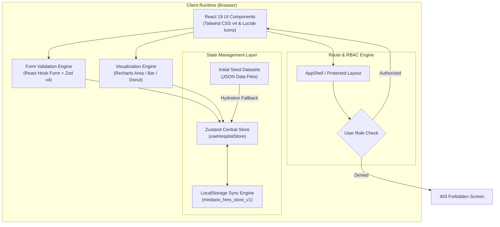
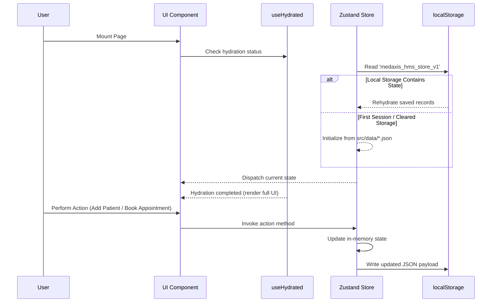

# System Architecture Specification

## 1. Architectural Overview

The **Virtual Code Tech Hospital Management System** (MedAxis HMS) is engineered as an enterprise-grade, client-first Single Page Application (SPA) leveraging **Next.js 16 (App Router)** and **React 19**. The system operates without an external server or traditional relational database, relying instead on a centralized state management layer with browser-level persistence (`localStorage`) and local seed datasets.

---

## 2. Next.js App Router Structure & Rendering Model

The application adopts the Next.js 16 App Router model with dynamic client-side hydration:

- **Root Layout (`src/app/layout.tsx`)**: Defines root font tokens (`Inter`), meta configurations, and executes an inline anti-flash script that syncs the dark mode class to `document.documentElement` before layout rendering.
- **Route Group `(dashboard)` (`src/app/(dashboard)/layout.tsx`)**: Wraps protected clinical and administrative routes inside a shared `<AppShell>` component. It is guarded by React Suspense to isolate dynamic navigation transitions.
- **Route Isolation**:
  - `/login`: Public authentication portal with credential quick-fill cards.
  - `/dashboard`: Executive statistics, Recharts analytics, and activity feeds.
  - `/patients` & `/patients/[id]`: Patient directory, intake forms, and profile records.
  - `/doctors` & `/doctors/[id]`: Physician registry, status toggles, and clinician profiles.
  - `/appointments`: Scheduling grid, day agenda, and interactive calendar.
  - `/billing` & `/billing/[id]`: Invoice ledger, automatic total calculations, and printable statements.
  - `/wards`: Real-time ward capacity tracking and bed occupancy tracker.

---

## 3. State Management & Persistence Lifecycle

Central state is managed through **Zustand 5** with the `persist` middleware.

1. **Hydration Safety**: To prevent React 19 hydration mismatch warnings between server markup and client browser storage, components use a custom `useHydrated` hook that gates interactive controls until browser mounting completes.
2. **Atomic Updaters**: All store methods perform immutable state modifications, ensuring predictable re-renders.
3. **Reset Capability**: An administrative reset function allows developers and evaluators to wipe local modifications and re-initialize datasets to pristine seed states at any time.

---

## 4. Role-Based Access Control (RBAC) Matrix

Access levels are evaluated on every route transition by `useRoleAccess`:

| Route Path | Admin Access | Doctor Access | Receptionist Access | Unauthenticated |
| :--- | :---: | :---: | :---: | :---: |
| `/login` | Public | Public | Public | Public |
| `/dashboard` | Granted | Granted | Granted | Redirect to `/login` |
| `/patients` | Full CRUD | View / Add / Edit | Full CRUD | Redirect to `/login` |
| `/patients/[id]` | Granted | Granted | Granted | Redirect to `/login` |
| `/doctors` | Full CRUD | Directory View | Directory View | Redirect to `/login` |
| `/doctors/[id]` | Full CRUD | Profile View | Profile View | Redirect to `/login` |
| `/appointments` | Full Control | Clinical Schedule | Full Control | Redirect to `/login` |
| `/billing` | Full Control | **403 Restricted** | Ledger & Invoice Creation | Redirect to `/login` |
| `/billing/[id]` | Full Control | **403 Restricted** | View & Print Invoice | Redirect to `/login` |
| `/wards` | Full Control | Bed Status View | Admit & Discharge | Redirect to `/login` |

---

## 5. UI/UX Design System & Accessibility

- **Color Tokens**: Standardized clinical palette using white, light blue (`#0284c7`), neutral slate tones, and high-contrast dark mode variants (`#0b1329` surface).
- **Typography**: Native Inter variable typography with clear hierarchical heading scales.
- **Micro-Interactions**: Hover states, active pressed states, and toast notifications dispatched via an accessible `aria-live="polite"` container.
- **Print Engine**: Dedicated `@media print` rules in `src/styles/print.css` remove navigation chrome, sidebars, and interactive buttons, rendering clean documents for invoices and executive summaries.
