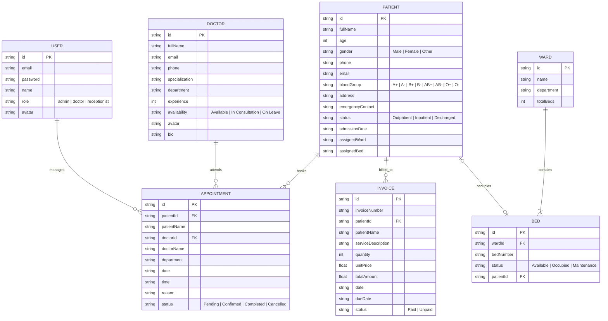

# Data Model & Storage Architecture

## 1. Zero-Backend Data Architecture

The **Virtual Code Tech Hospital Management System** operates with zero external database dependencies. Data persistence is powered entirely by:

1. **Seed Datasets (`src/data/*.json`)**: Immutable baseline records shipped with the application bundle.
2. **Browser LocalStorage**: Persistent client-side key-value storage (`medaxis_hms_store_v1`) synchronized seamlessly via Zustand.
3. **In-Memory Cache**: Reactive Zustand store driving instantaneous UI updates without network latency.

---

## 2. Entity-Relationship Model (Client-Side Relational Schema)

Although stored as JSON documents, records maintain strict relational integrity across IDs:

---

## 3. Seed Datasets Overview

The initial state is pre-populated with realistic clinical records located in `src/data/`:

| Dataset File | Entity Type | Initial Count | Description |
| :--- | :--- | :---: | :--- |
| `users.json` | System Accounts | 3 | Admin, Chief Doctor, and Receptionist authentication credentials |
| `patients.json` | Patient Records | 14 | Fictional clinical profiles with diverse blood groups and admission states |
| `doctors.json` | Medical Staff | 8 | Multi-specialty physician registry with local portrait assets |
| `appointments.json` | Schedules | 18 | Multi-status consultations spanning current, past, and upcoming dates |
| `invoices.json` | Financials | 12 | Standardized medical fee line items with auto-computed sums |
| `wards.json` | Hospital Facilities | 6 wards / 24 beds | Inpatient departments (ICU, Cardiology, Pediatrics, etc.) with real-time occupancy |

---

## 4. Referential Integrity & Cascading Actions

The state store enforces business rules across entities:

1. **Patient Deletion**: When a patient is removed, any beds occupied by that patient in `wards` are automatically discharged and set back to `Available`.
2. **Bed Allocation**: Assigning a patient to a bed automatically marks the bed as `Occupied` and links the `patientId`. Discharging updates the bed status to `Available` and clears the assignment on the patient record.
3. **Invoice Auto-Calculation**: Invoices automatically maintain `$totalAmount = quantity \times unitPrice$`.
4. **Data Reset**: The store exposes `resetToDemoData()` which purges `localStorage` and reloads all initial JSON fixtures in a single transaction.
