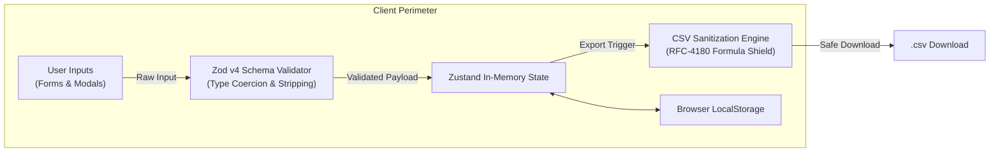

# Security & Data Privacy Policy

## 1. Security Architecture & Threat Model

The **Virtual Code Tech Hospital Management System** is a client-first demonstration application engineered for academic and portfolio evaluation. The security model addresses the following core vectors:

---

## 2. Privacy by Design: Zero Real-World Medical Data

- **Synthetic Records**: All patient identities, demographics, diagnoses, telephone numbers, emails, and financial transactions are 100% fictional.
- **No Protected Health Information (PHI)**: The application does not store, transmit, or process any real clinical records or HIPAA-governed information.
- **Zero Backend Exposure**: Because no remote database or server endpoints are used, there are no remote API attack surfaces, database credentials, or server-side leaks.

---

## 3. Client-Side Input Validation & Sanitization

1. **Strict Zod Schemas**: Every form submission (`Patient`, `Doctor`, `Appointment`, `Invoice`, `Auth`) is validated against strict Zod v4 schemas (`patient-schema.ts`, etc.) before state updates occur.
2. **Formula Injection Defense (CSV)**: All CSV exports pass through a sanitization function in `src/lib/csv.ts` that escapes cells starting with formula prefixes (`=`, `+`, `-`, `@`) to prevent CSV injection attacks in spreadsheet tools like Microsoft Excel and Google Sheets.
3. **XSS Protection**: React 19 automatically escapes rendered text strings in JSX, preventing Cross-Site Scripting vulnerabilities in user inputs.

---

## 4. Role-Based Route Gating

- Route authorization is enforced by the `useRoleAccess` hook and the root `AppShell` layout.
- Non-administrative accounts (such as `Doctor`) attempting to access sensitive administrative routes (such as `/billing`) are intercepted and presented with a standard 403 Forbidden alert screen.
- Unauthenticated requests are immediately redirected to the `/login` route.

---

## 5. Security Checklist for Production Hardening

If connecting this application to a real production backend in the future:

- [ ] Replace mock authentication with a modern OAuth2 / OIDC provider (e.g., Auth0, NextAuth, Firebase Auth).
- [ ] Implement HttpOnly, Secure, SameSite cookies for session tokens.
- [ ] Enforce HTTPS with strict HSTS headers.
- [ ] Connect to an encrypted-at-rest database (e.g., PostgreSQL with TLS).
- [ ] Establish audit logging for HIPAA / GDPR access compliance.
